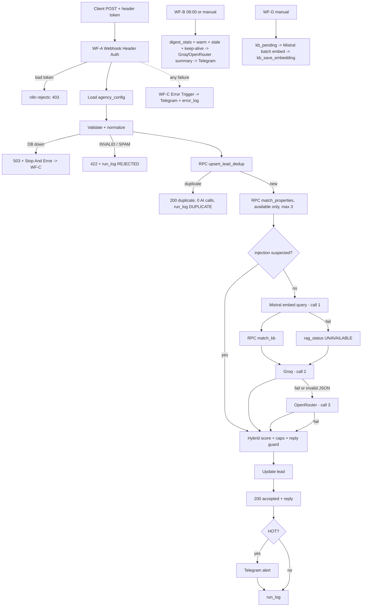

# PropLead Concierge

**AI lead qualification, property matching and instant escalation, built with n8n, Supabase, Groq, OpenRouter, Mistral and Telegram.**

Author: **Khalid Mostafiq Mahim**

> **Please read first**
> - This is a **self-initiated portfolio project**. It is **not** a paid client project and **not** a production deployment.
> - All demonstration data is **synthetic**: a fictional agency (Harbor & Pine Realty), invented leads, `example.com` email addresses and reserved test phone numbers.
> - It was **built and tested on an n8n Cloud trial**. It is not live.

---

## The problem

When a property enquiry arrives, the agency that replies first usually wins the client. Small agencies often read enquiries by hand, so urgent buyers and renters wait hours while casual browsers take the same attention. Replies written in a hurry can also promise things the agency cannot deliver, such as a listing that is already let.

## The solution

PropLead Concierge is an automation that receives each website enquiry, checks it, scores how serious and urgent it is, matches it to **available** properties only, drafts a **grounded reply**, and alerts the sales team on Telegram when the lead is HOT.

## What it does

1. Accepts an enquiry through a **token-protected webhook**.
2. **Validates and cleans** the data (email, phone, length) and rejects spam and invalid requests.
3. Flags **prompt-injection attempts** and keeps AI out of those cases.
4. **Detects duplicates** by email or phone and updates the existing lead instead of creating a new row.
5. **Matches available properties** by area, budget and bedrooms.
6. **Retrieves policy text** from a 17-document knowledge base (embeddings stored in Supabase pgvector).
7. Asks **Groq** for a score and a draft reply. **OpenRouter** is the only backup. If both fail, a **rules-only** score is used.
8. Combines **business rules (0-60)** with the **AI score (0-40)** and applies deterministic caps.
9. Checks the reply with a **guard** (no invented numbers or listings, no viewing promises, length limit). A safe template is used if the guard rejects it.
10. Stores the lead and returns the result and the **draft reply in the webhook response**.
11. Routes the lead:

| Category | Meaning | Action |
|---|---|---|
| HOT (score 70+) | Urgent, serious, matches a property | Instant Telegram alert (no email, phone or message text) |
| WARM (40-69) | Interested, no urgency | Included in the daily digest |
| COLD (below 40) | Browsing, no match or out of area | Saved and logged |
| SPAM / INVALID | Rejected by deterministic rules | HTTP 422 and logged |

> **Note:** the draft reply is returned to whatever system calls the webhook. PropLead Concierge does **not** send emails, SMS or WhatsApp messages to leads. Telegram is the only notification channel.

## Architecture


Editable Mermaid version below; the PNG and SVG in `assets/` were drawn separately from the same structure.



More detail: [docs/architecture.md](docs/architecture.md), [docs/data_contracts.md](docs/data_contracts.md), [docs/database_design.md](docs/database_design.md).

## The four workflows

| Workflow | Nodes | Purpose |
|---|---|---|
| WF-A Intake Pipeline | 34 | The main pipeline described above |
| WF-B Daily Digest | 20 | Category counts, WARM list, stale leads, short AI summary, Telegram, database keep-alive (manual run verified; schedule kept inactive) |
| WF-C Global Error Handler | 6 | Error trigger, scrubs personal data, Telegram error notice, error log |
| WF-D KB Ingestion | 13 | Embeds only new or changed knowledge-base documents with Mistral |

## Results (see [docs/test_results.md](docs/test_results.md) for the evidence and its limits)

| Check | Result | Important caveat |
|---|---|---|
| 20 labeled London leads (7 HOT, 7 WARM, 6 COLD) | Run 1: 16/20. Runs 2, 3 and 4: **20/20** | The score caps were designed after seeing Run 1 on the **same 20 leads**, so 20/20 is a tuned result, not an independent test |
| HOT alert speed | 7 of 7 alerts recorded **1.5 to 5.9 seconds** after the lead was saved (Run 4) | Measured from database insert to the recorded Telegram success; excludes webhook authentication and delivery to a phone |
| AI and embedding calls per new lead | **At most 3** (2 normally, 3 when Groq fails) | Duplicates and injection-flagged leads use 0 |
| Reply safety (Run 4) | SQL audit: all 20 replies passed the reference and promise checks; 7 HOT replies were also read by hand | The audit uses the same patterns as the guard; third-person phrases such as "an agent will confirm a slot" are allowed on purpose |
| Edge cases | Duplicate, missing email, long message, Spanish, prompt injection, no match, out of area, spam, invalid all behaved as expected | Wrong token returns 403 and malformed JSON returns 422; both come from n8n itself |
| Database unavailable | 503 response, Telegram error alert and error log row | Proven on an earlier version (v1.0), not re-run on v1.1 |
| Fallback chain | Groq to OpenRouter (FALLBACK) and rules-only (UNAVAILABLE) both observed | OpenRouter free models are unstable |
| Portability | A second agency (Manchester) worked by changing database rows only, no workflow edit | Tested on v1.0 with three leads |

Evidence files: [tests/results_labeled.csv](tests/results_labeled.csv) (Run 4), [tests/results_edge.csv](tests/results_edge.csv) (v1.1), [tests/results_manchester.csv](tests/results_manchester.csv).

## Not included (not built, not claimed)

Sending replies to leads by email, SMS or WhatsApp; CRM integration; a dashboard or user interface; voice or multi-agent features; payments; independent holdout testing; production hosting.

## Technology

n8n Cloud trial, Supabase Postgres with pgvector, Groq (`openai/gpt-oss-120b`), OpenRouter free router (`openrouter/free`), Mistral `mistral-embed` (1024 dimensions), Telegram Bot API. Everything ran on free tiers; free limits were not re-verified, so check current limits before relying on them.

## Repository structure

```
PropLead-Concierge/
├── README.md
├── MASTER_CASE_STUDY.md
├── SETUP_GUIDE.md
├── TROUBLESHOOTING_GUIDE.md
├── SECURITY_NOTES.md
├── .env.example
├── workflows/        WF-A, WF-B, WF-C, WF-D (credentials removed)
├── database/         schema.sql, seed_london.sql, seed_manchester.sql and helper SQL
├── tests/            test runner, labeled leads, results CSVs
├── docs/             architecture, data contracts, database design, test plan and results,
│                     fixing note, cost estimate, credentials checklist, screenshots/
└── assets/           architecture diagram (PNG, SVG, Mermaid source), social preview, case study PDF
```

## Quick start

Full steps are in [SETUP_GUIDE.md](SETUP_GUIDE.md). In short:

1. Create a free Supabase project and run `database/schema.sql` then `database/seed_london.sql`.
2. Create the n8n credentials listed in `.env.example` and `docs/credentials_checklist.md`.
3. Import the four files from `workflows/`, bind the credentials, set the error workflow to WF-C.
4. Run WF-D once to embed the knowledge base, then publish WF-A and WF-C.
5. Send a test enquiry with the example in the setup guide, or run `python3 tests/proplead_tests.py labeled`.

## Demo video

Demo video link: **[add the link here after recording]**

## Screenshots

One genuine screenshot is included: [Telegram daily digest and error alert](docs/screenshots/telegram_daily_digest_and_error_alert.png) (phone screenshot of the bot chat). More real screenshots will be added after they are captured. The full write-up is in [assets/PropLead_Concierge_Case_Study.pdf](assets/PropLead_Concierge_Case_Study.pdf).

## Security

No keys, tokens, chat ids or instance URLs are stored in this repository. See [SECURITY_NOTES.md](SECURITY_NOTES.md).

## Known limitations

English-only timeline rules. The reply guard blocks invented facts and first-person viewing promises but cannot catch every possible phrasing. Two database steps continue on error without a dedicated alert. The digest runs at a fixed 08:00 instead of reading the configured hour. One agency is active at a time. Rejections for a wrong token or malformed JSON happen inside n8n and are not written to the run log. There is no rate limit and no daily cap on AI calls. Free-tier AI providers may change, throttle or retain prompts. Full list: [MASTER_CASE_STUDY.md](MASTER_CASE_STUDY.md) and [docs/test_results.md](docs/test_results.md).

## Troubleshooting

See [TROUBLESHOOTING_GUIDE.md](TROUBLESHOOTING_GUIDE.md).

## Production path

Import the four JSON files into a self-hosted n8n Community Edition and keep Supabase (or any Postgres with pgvector). Self-hosting has not been tested yet. Paid LLM capacity may be needed for reliability.

## License

MIT. See [LICENSE](LICENSE).

## Author

**Khalid Mostafiq Mahim**, AI automation developer.
