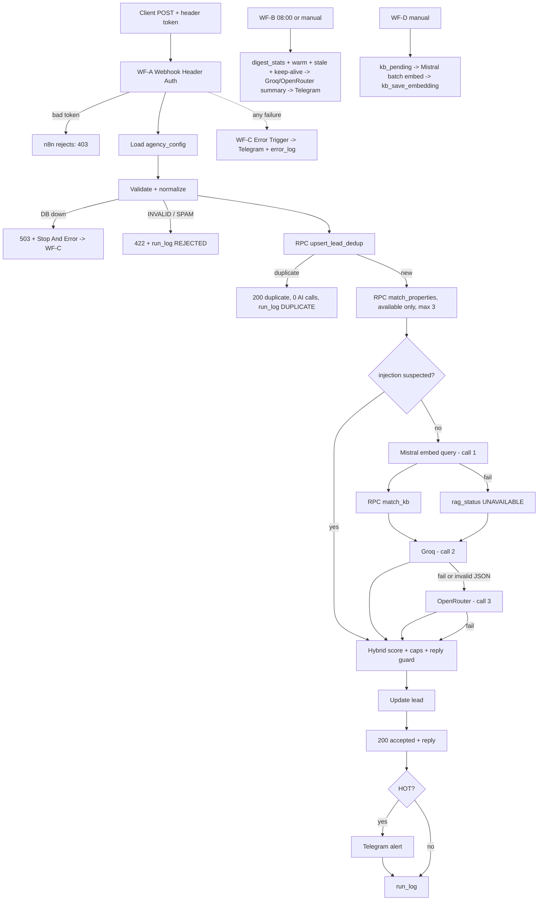

# PropLead Concierge - Architecture (v1.1)

Fictional agency: Harbor & Pine Realty. Demo city: London. Portability test: Manchester (verified, see test_results.md).
All agency-specific data (name, city, currency, areas, hours, thresholds, model IDs) is read from `agency_config` at runtime. No city, currency or agency name is hardcoded in workflow nodes or prompts.

## Stack (free tiers, no payment method added)
| Layer | Service | Note |
|---|---|---|
| Orchestration | n8n Cloud trial | Four workflows, exported as JSON |
| DB + vectors | Supabase Postgres + pgvector `vector(1024)` | Accessed with n8n Postgres nodes (credential `Postgres account`) |
| Primary LLM | Groq, model from `agency_config.settings.llm.groq_model` (`openai/gpt-oss-120b`) | One combined call: signals + reply |
| Fallback LLM | OpenRouter free router (`openrouter/free`) | Used only if Groq fails or returns invalid JSON |
| Embeddings | Mistral `mistral-embed`, 1024 dims | `POST https://api.mistral.ai/v1/embeddings` |
| Alerts | Telegram Bot API | HOT alerts, daily digest, error notices |

Gemini is not used anywhere.

## Diagram

## Workflows
- **WF-A Intake Pipeline** (webhook, 34 nodes): auth -> config -> validate/normalize -> atomic dedupe -> property match -> embed -> KB search -> LLM -> hybrid score -> reply guard -> store -> respond -> HOT alert -> run_log.
- **WF-B Daily Digest** (schedule + manual): 24h category counts (SPAM/INVALID from run_log), WARM list, stale HOT/WARM leads, keep-alive, short AI summary with template fallback, Telegram.
- **WF-C Global Error Handler**: Error Trigger -> sanitize (emails, phones, tokens scrubbed) -> Telegram -> error_log. Skips itself.
- **WF-D KB Ingestion** (manual): pending docs by content hash -> one Mistral batch call per 8 docs -> save embedding.

## Call budget (max 3 per new lead)
Embedding 1 + Groq 1 + OpenRouter 1. Duplicates use 0. Injection-suspected leads use 0 AI calls. Observed: 2 calls normally, 3 on fallback, 0 on injection/duplicate.
DECISION (documented deviation from "retry once"): a separate Groq retry does not fit in 3 calls, so the OpenRouter call acts as the retry.

## Hybrid scoring (0-100)
- Rules 0-60: budget fit (15), timeline keywords (15), contact completeness (10), specificity (10), area + property match (10).
- LLM 0-40: intent (20) + urgency (10) + seriousness (10); validated, clamped; ignored if injection suspected or AI unavailable (rules scaled to 100).
- Thresholds in `settings`: HOT >= 70, WARM >= 40.
- Caps (added in v1.0 after labeled test run 1): no urgency/viewing evidence (time score < 8) -> cannot be HOT; no matching available property -> cannot be WARM or HOT; out of service area or LLM spam flag -> COLD.
- SPAM/INVALID are decided only by deterministic rules.

## Reply safety
Reply model sees only the delimited lead message, matched DB properties and retrieved KB text. A Code-node guard rejects replies containing numbers or property refs not in the allowed facts, promise words, viewing-promise phrases ("I'll arrange/book/confirm a viewing"), or more than 120 words; a template reply is used instead.

## Security
Header Auth on webhook; service credentials only in n8n; RLS enabled with no public policies; logs hold lead_id, never raw email/phone/message; Telegram alerts have no contact data; bounded timeouts, no loops, WF-C cannot trigger itself.

## Failure behaviour
| Failure | Behaviour | Evidence |
|---|---|---|
| Groq down/invalid | OpenRouter | Verified (E09, FALLBACK, calls 3) |
| Groq + OpenRouter fail | rules-only, ai_status UNAVAILABLE | Verified (twice) |
| Mistral/KB failure | continue without RAG | Not tested |
| Supabase down | 503 + WF-C alert + error_log row | Verified (E10, 3 Nov 2026, run on v1.0) |
| Telegram down | lead saved, error_log row | Not tested |
